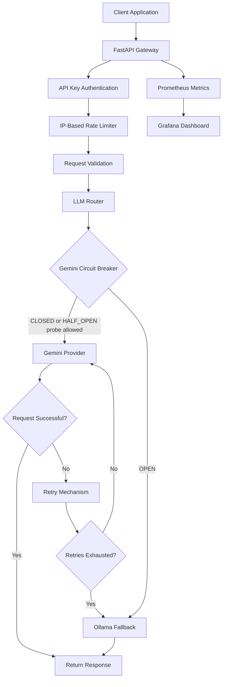

# Self-Healing LLM Gateway

A reliable LLM gateway built with **FastAPI**, **LiteLLM**, **Gemini**, and **Ollama**. It improves request reliability through automatic provider fallback, retry mechanisms, circuit breaking, API-key authentication, and rate limiting.

Prometheus and Grafana provide monitoring and visibility into gateway performance.

## Features

### Reliability
- Gemini as the primary LLM provider.
- Ollama as the local fallback provider.
- Automatic fallback when Gemini requests fail.
- Configurable retry attempts with exponential backoff and jitter.
- Support for provider-supplied `Retry-After` delays.
- Circuit breaker with CLOSED, OPEN, and HALF_OPEN states.
- Protection against stale concurrent responses and cancelled recovery probes.

### API and Security
- FastAPI-based REST API.
- API-key authentication through the `X-API-Key` header.
- Constant-time API-key comparison.
- IP-based rate limiting: 10 requests per 60 seconds.
- Request validation, including prompt length limits.
- Safe error responses that avoid exposing provider details to API clients.

### Monitoring
- Prometheus metrics for request counts and latency.
- Circuit breaker state monitoring.
- Provider failure and fallback counters.
- Request IDs and structured request logging.
- Liveness, health, and readiness endpoints.
- Grafana monitoring dashboard.

### Deployment and Testing
- Docker and Docker Compose support.
- Prometheus and Grafana integration.
- Automated tests for retries, circuit breaking, concurrency, cancellation, authentication, and API behavior.
- GitHub Actions CI workflow.


## Architecture



## Technology Stack

| Component | Technology |
|---|---|
| Backend | Python, FastAPI |
| LLM integration | LiteLLM |
| Primary provider | Google Gemini |
| Fallback provider | Ollama |
| Reliability | Retry logic, circuit breaker |
| Authentication | API key |
| Rate limiting | In-memory IP-based limiter |
| Metrics | Prometheus |
| Dashboards | Grafana |
| Containerization | Docker, Docker Compose |
| CI/CD | GitHub Actions |

## Project Structure

```text
self-healing-llm-gateway/
│
├── .github/
│   └── workflows/
│       └── ci.yml
│
├── app/
│   ├── __init__.py
│   ├── circuit_breaker.py
│   ├── config.py
│   ├── main.py
│   ├── metrics.py
│   ├── providers.py
│   └── rate_limiter.py
│
├── monitoring/
│   └── prometheus.yml
│
├── .dockerignore
├── .gitignore
├── Dockerfile
├── docker-compose.yml
├── requirements.txt
│
└── test_*.py
```

## Prerequisites

- Python 3.12
- Docker Desktop with Docker Compose
- A Google Gemini API key
- Ollama installed locally for the fallback provider
- Git

For the local fallback, install the configured Ollama model:

```powershell
ollama pull llama3.2:1b
```

## Configuration

Create a `.env` file in the project root:

```env
GEMINI_API_KEY=your_gemini_api_key
GATEWAY_API_KEY=your_gateway_api_key
```

Use your own credentials. Never commit `.env` or expose API keys in source code.

The Docker Compose configuration loads these variables into the application container. The Ollama API address is configured separately in Docker Compose.

## Run with Docker

Build and start the application and monitoring services:

```powershell
docker compose up -d --build
```

Check container status:

```powershell
docker compose ps
```

View application logs:

```powershell
docker compose logs -f app
```

Stop the services:

```powershell
docker compose down
```

## Run Locally

Create and activate a virtual environment:

```powershell
python -m venv .venv
.\.venv\Scripts\Activate.ps1
```

Install dependencies:

```powershell
pip install -r requirements.txt
```

Start the application:

```powershell
python -m uvicorn app.main:app --reload
```

The local API is available at:

`http://localhost:8000`

Interactive API documentation:

`http://localhost:8000/docs`

## API Usage

### POST /chat

Generate an LLM response.

**Request headers:**

```http
Content-Type: application/json
X-API-Key: your_gateway_api_key
```

**Request body:**

```json
{
  "prompt": "Explain how a circuit breaker works."
}
```

**Example PowerShell request:**

```powershell
$headers = @{
    "X-API-Key" = "your_gateway_api_key"
}

$body = @{
    prompt = "Explain how a circuit breaker works."
} | ConvertTo-Json

Invoke-RestMethod `
    -Uri "http://localhost:8000/chat" `
    -Method POST `
    -Headers $headers `
    -ContentType "application/json" `
    -Body $body
```

**Successful response:**

```json
{
  "response": "A circuit breaker monitors failures..."
}
```

### Health Endpoints

| Endpoint | Purpose |
|---|---|
| `GET /` | Basic service information |
| `GET /health` | Gateway and circuit-breaker status |
| `GET /health/live` | Liveness check |
| `GET /health/ready` | Provider readiness check |
| `GET /metrics` | Prometheus metrics |
| `POST /chat` | Authenticated LLM request |

## Monitoring

Once Docker Compose is running:

| Service | URL |
|---|---|
| FastAPI | http://localhost:8000 |
| API documentation | http://localhost:8000/docs |
| Prometheus | http://localhost:9090 |
| Grafana | http://localhost:3000 |
| Metrics | http://localhost:8000/metrics |

Prometheus scrapes the gateway metrics endpoint.

The Grafana dashboard displays:

- Total chat requests
- Chat request rate
- Chat request latency
- Gemini circuit-breaker state
- Fallback attempts and rate
- Provider failures
- Chat failure rate

## Running Tests

Run the test suites from the project root:

```powershell
python test_circuit_breaker.py
python test_retries.py
python test_concurrency.py
python test_cancellation.py
python test_retry_circuit.py
python test_gateway.py
```

The tests cover:

- Circuit-breaker state transitions.
- Retry behavior and retry delays.
- Concurrent requests and stale responses.
- Request cancellation.
- Retry and circuit-breaker interaction.
- API authentication and prompt validation.
- Fallback behavior and Prometheus metrics.
- Health and readiness endpoints.

GitHub Actions automatically runs the test suites on pushes and pull requests to the `main` and `master` branches.

## Design Considerations and Limitations

- The circuit breaker and rate limiter use in-memory state. They are designed for a single application process and do not coordinate state across multiple instances.
- Rate-limit counters reset when the application restarts.
- The readiness endpoint checks Gemini configuration and circuit-breaker state, rather than performing a live Gemini API request.
- Ollama must be running and the configured model must be available for local fallback.

## Future Improvements

- Distributed rate limiting.
- Distributed circuit-breaker state.
- More comprehensive alerting rules.
- Additional provider integrations.
- Deployment to a cloud environment.

## Author

**Irfan Shaik**

GitHub: [@shaikirfan2301](https://github.com/shaikirfan2301)

Project: [Self-Healing LLM Gateway](https://github.com/shaikirfan2301/self-healing-llm-gateway)