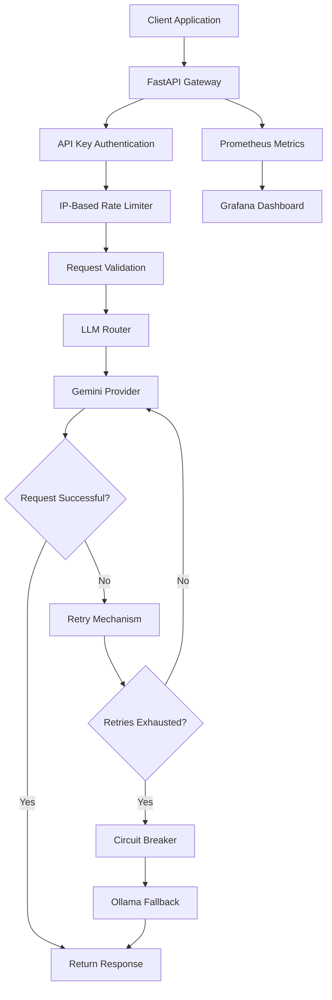
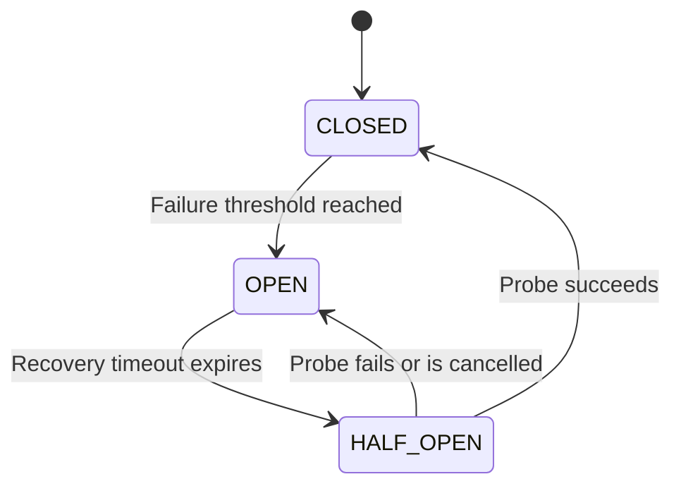

# System Architecture — Self-Healing LLM Gateway

## 1. Overview

The Self-Healing LLM Gateway is a Python-based API service that provides a reliability layer between client applications and Large Language Model (LLM) providers.

It uses Google Gemini as its primary provider and Ollama as a local fallback provider.

The gateway implements retry mechanisms, circuit breaking, provider fallback, API-key authentication, rate limiting, and monitoring.

The system is designed to handle temporary provider failures while maintaining a consistent API interface for client applications.

## 2. High-Level Architecture

## 3. Request Lifecycle

A client sends a POST request to `/chat`.

The gateway processes the request in the following order:

1. **Request tracking:** Middleware generates a unique request ID and starts measuring request duration.
2. **Authentication:** The gateway validates the `X-API-Key` header.
3. **Rate limiting:** The request is checked against the client's IP-based request limit.
4. **Validation:** Pydantic validates the prompt, including its length and non-empty content.
5. **Provider routing:** The gateway attempts to generate a response using Gemini.
6. **Retry and recovery:** Temporary provider failures trigger retry logic. If Gemini remains unavailable, the gateway attempts Ollama.
7. **Response:** The generated answer is returned to the client.
8. **Monitoring:** Request counts, latency, provider failures, and fallback activity are recorded.

Successful responses include an `X-Request-ID` header.

## 4. Provider Routing and Fallback

The gateway uses two LLM providers.

| Provider | Role | Model |
|---|---|---|
| Google Gemini | Primary | `gemini-3.5-flash-lite` |
| Ollama | Fallback | `llama3.2:1b` |

The provider routing logic is implemented in `app/providers.py`.

### Gemini primary provider

The gateway attempts to call Gemini first.

If the request encounters a retryable error, the gateway retries the request up to three attempts.

### Ollama fallback provider

If Gemini cannot complete the request, the gateway attempts to use the local Ollama model.

A successful Ollama response is returned through the same `/chat` endpoint.

The client does not need to implement separate provider-specific request logic.

A successful Ollama response does not reset Gemini's circuit-breaker failure count.

## 5. Retry Mechanism

The retry mechanism handles temporary provider failures.

Current configuration:

| Setting | Value |
|---|---|
| Maximum attempts | 3 |
| Backoff strategy | Exponential backoff |
| Randomization | Jitter |
| Provider guidance | `Retry-After` header |

The retry delay increases between attempts.

When a provider supplies a valid `Retry-After` value, the gateway uses that delay with a small random jitter.

Otherwise, it uses exponential backoff with jitter.

Authentication and other non-retryable errors are not retried.

This reduces unnecessary repeated requests when a provider is unavailable or rate-limiting traffic.

## 6. Circuit Breaker

The circuit breaker prevents repeated requests to a provider that is consistently failing.

It is implemented in `app/circuit_breaker.py`.

The Gemini circuit breaker uses three states.

### CLOSED

- Requests are allowed.
- Provider failures are counted.
- Successful requests reset the failure count.
- The circuit opens after three consecutive recorded failures.

### OPEN

- New Gemini requests are rejected immediately.
- The gateway can attempt the Ollama fallback.
- The circuit remains open until the recovery timeout expires.

### HALF_OPEN

- After the recovery timeout, a limited recovery probe is allowed.
- A successful probe closes the circuit.
- A failed or cancelled recovery probe returns the circuit to OPEN.

Current configuration:

| Setting | Value |
|---|---|
| Failure threshold | 3 |
| Recovery timeout | 30 seconds |
| Half-open probes | One at a time |

### State transitions

### Concurrency protection

The circuit breaker uses request tokens and generation tracking to prevent stale requests from modifying newer circuit-breaker state.

This is important when multiple requests overlap.

For example, if one request opens the circuit while another older request is still running, a late success from the older request must not incorrectly close the circuit.

The implementation also protects the half-open recovery probe so that only one probe is active at a time.

## 7. Authentication and Rate Limiting

### API-key authentication

The `/chat` endpoint requires an API key in the `X-API-Key` request header.

The key is configured through the `GATEWAY_API_KEY` environment variable.

The gateway uses Python's `secrets.compare_digest()` for constant-time key comparison.

Requests with missing or invalid keys receive HTTP 401.

### Rate limiting

The gateway implements IP-based rate limiting.

| Setting | Value |
|---|---|
| Request limit | 10 |
| Time window | 60 seconds |
| Rejection status | HTTP 429 |

Requests exceeding the limit receive a `Retry-After` response header.

The limiter uses an in-memory sliding-window approach based on request timestamps.

## 8. Health Checks and API Endpoints

| Endpoint | Description |
|---|---|
| `GET /` | Basic application health information |
| `GET /health` | Gateway health and Gemini circuit-breaker state |
| `GET /health/live` | Liveness check |
| `GET /health/ready` | Provider readiness check |
| `POST /chat` | Authenticated LLM generation endpoint |
| `GET /metrics` | Prometheus metrics endpoint |

The readiness endpoint checks whether Gemini is configured and its circuit breaker is closed, or whether the configured Ollama model is available.

## 9. Observability and Monitoring

The gateway exports metrics using the Prometheus client library.

Important metrics include:

| Metric | Description |
|---|---|
| `gateway_requests_total` | Total HTTP requests |
| `gateway_request_duration_seconds` | Request processing duration |
| `gateway_circuit_breaker_state` | Current Gemini circuit-breaker state |
| `gateway_fallback_total` | Fallback attempts |
| `gateway_provider_failures_total` | Provider failures |

Prometheus scrapes the gateway's `/metrics` endpoint.

Grafana visualizes the collected metrics through the Self-Healing LLM Gateway Monitoring dashboard.

The dashboard includes request volume, request rate, latency, circuit-breaker state, fallback activity, provider failures, and chat failure rate.

## 10. Deployment Architecture

The application and monitoring services are managed using Docker Compose.

| Service | Responsibility |
|---|---|
| FastAPI application | Gateway API and provider routing |
| Prometheus | Metrics collection |
| Grafana | Metrics visualization |
| Ollama | Local fallback inference |

The FastAPI application runs inside a Docker container.

Ollama runs on the host machine and is accessed by the container through `host.docker.internal`.

Prometheus and Grafana run as separate containers.

## 11. Testing and Continuous Integration

The project includes automated tests for:

- Circuit-breaker state transitions.
- Retry behavior and provider-directed retry delays.
- Concurrent request handling.
- Cancellation of recovery probes.
- Stale request protection.
- API authentication.
- Prompt validation.
- Provider fallback.
- Prometheus metrics.
- Health and readiness endpoints.

GitHub Actions runs the automated test suites on pushes and pull requests to the configured branches.

The CI workflow installs Python dependencies, compiles the application, and executes the test suites.

## 12. Design Limitations

The current implementation is designed for a single application process.

- Circuit-breaker state is held in memory and is not shared across multiple application instances.
- Rate-limit state is held in memory and resets when the application restarts.
- Gemini readiness is inferred from configuration and circuit-breaker state rather than a live provider health request.
- Ollama fallback requires the local Ollama service and configured model to be available.
- The current rate limiter is suitable for a single-process deployment, not a distributed production environment.

These limitations are documented design trade-offs rather than claims of distributed fault tolerance.

## 13. Future Improvements

Potential future enhancements include:

- Distributed rate limiting.
- Shared circuit-breaker state across instances.
- Additional LLM provider integrations.
- More comprehensive alerting.
- Cloud deployment and automated release workflows.

---

**Project:** Self-Healing LLM Gateway  
**Repository:** https://github.com/shaikirfan2301/self-healing-llm-gateway  
**Author:** Irfan Shaik
